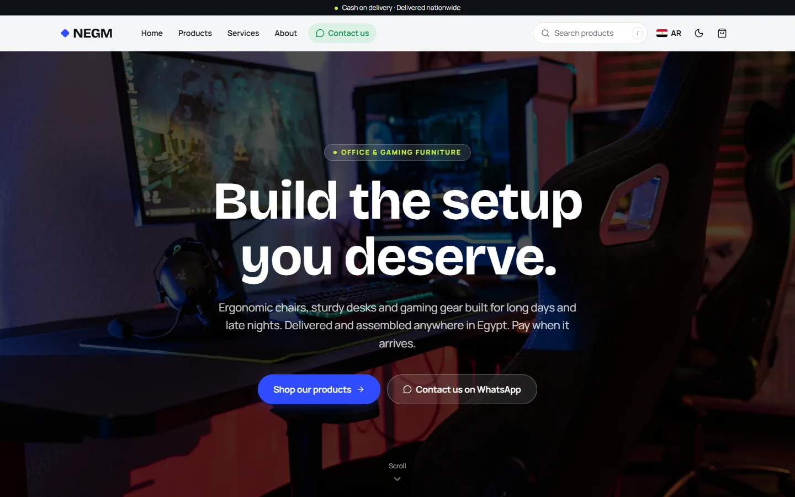
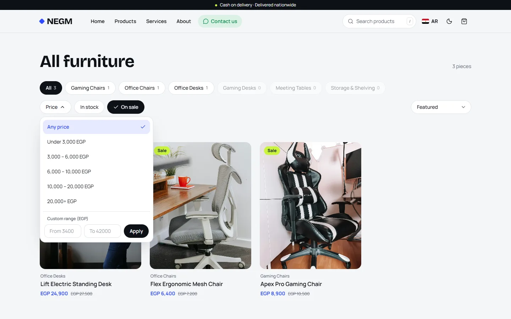
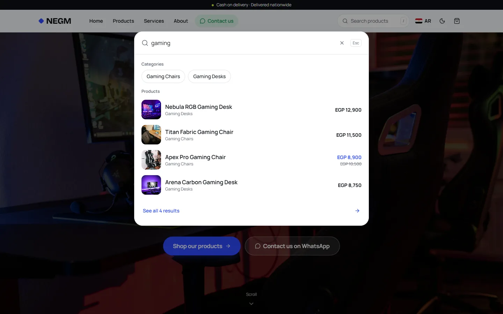
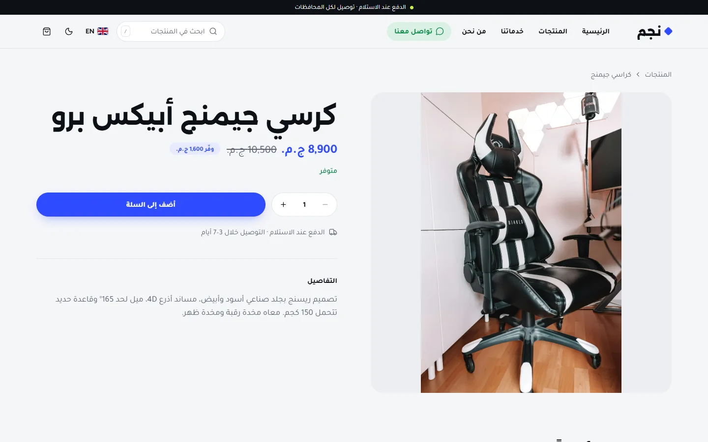
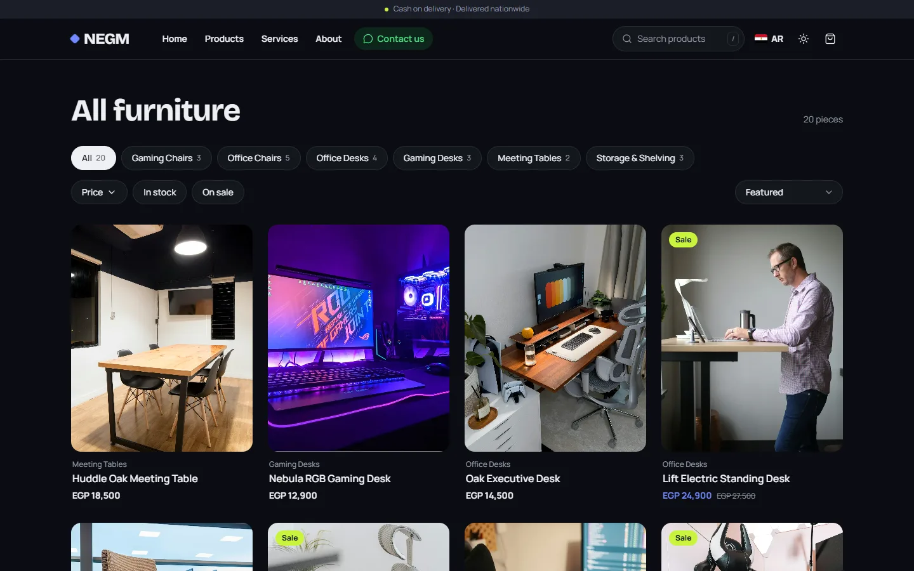
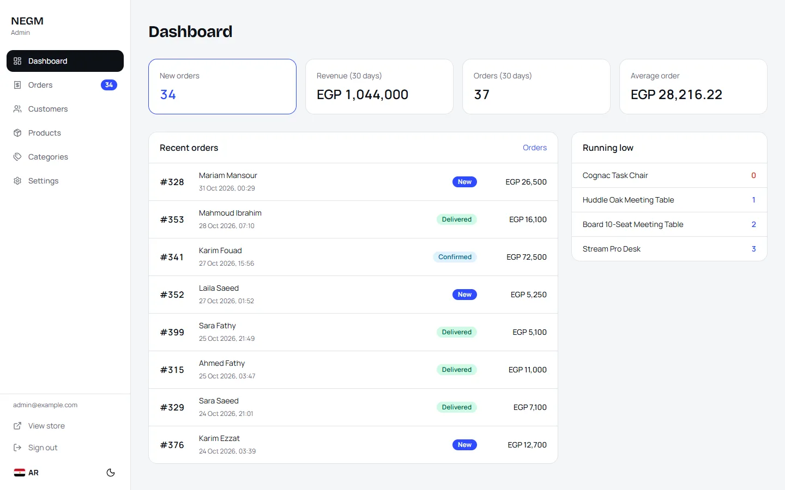
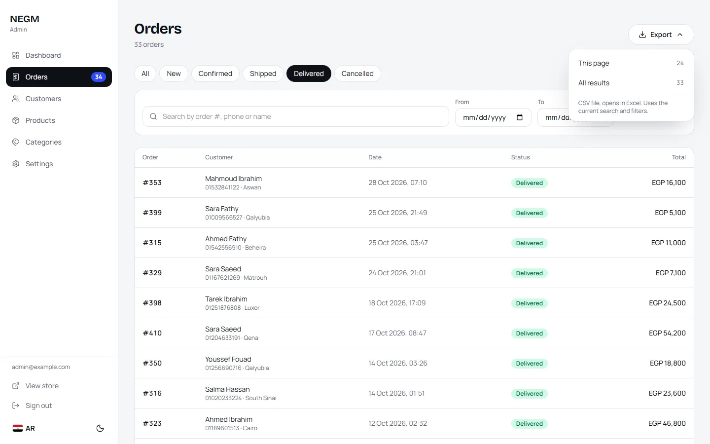
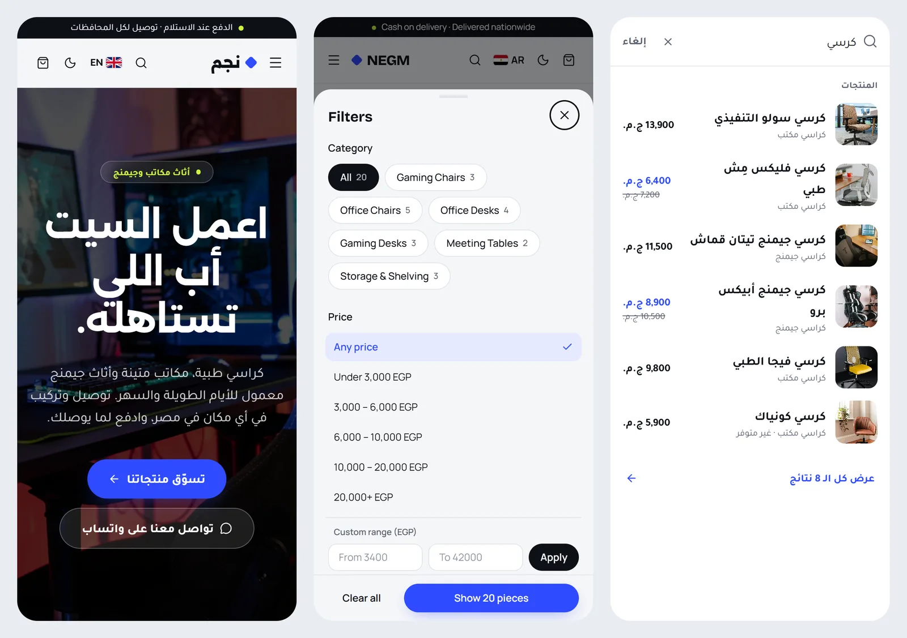
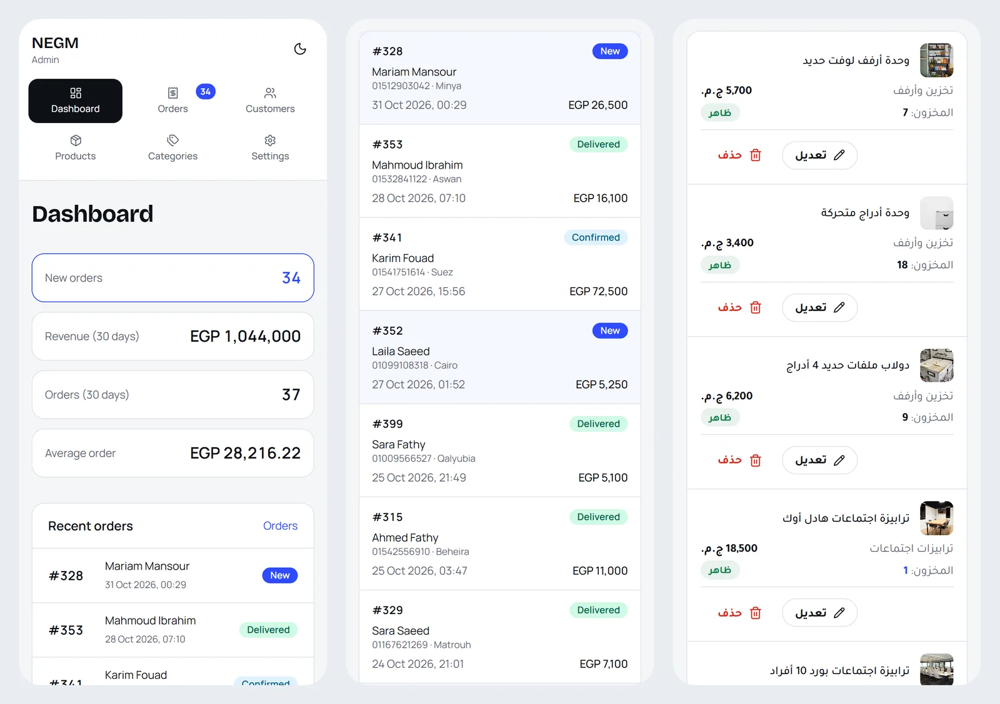

# NEGM: Bilingual E-commerce Platform

[](https://github.com/yousefalnaggar/Negm/actions/workflows/ci.yml)


A full-stack online store with a customer storefront and an admin dashboard in one Next.js app. It is fully bilingual, Arabic (right-to-left) and English, with light and dark themes and cash-on-delivery checkout, and works on every screen down to 320px phones.

It's built as a **reusable platform**: everything specific to a store (name, colors, texts, photos, catalogue, market rules) lives in a few known places, so the same code can run many shops. **NEGM (نجم)**, an office and gaming furniture store in Egypt, is the first.



---

## Highlights

- **Storefront:** shop with instant filters and category counts, live header search, product gallery, guest cart, cash-on-delivery checkout, and a private order-tracking link.
- **Admin dashboard:** sales overview, order workflow with packing slips, customers, products with multi-photo upload, categories, store settings, and CSV export.
- **Correct under load:** checkout reduces stock and creates the order in a single transaction with conditional updates, so two buyers can never both get the last item. An idempotency key turns double-submits into one order.
- **Fast by design:** every page runs a fixed number of parallel queries (no N+1), with database-level paging, grouped counts and deterministic sorting.
- **Arabic-first:** right-to-left layout, Arabic plural rules, and search that handles Arabic spelling variants and words in any order.
- **Production-ready:** multi-stage Docker image with migrations on start, a health check, no secrets in the image, rate limiting, security headers, and server-side authorization everywhere.

---

## Screenshots

| Shop filters | Live search |
| --- | --- |
|  |  |
| **Arabic, right to left** | **Dark mode** |
|  |  |
| **Admin dashboard** | **Orders with filters and CSV export** |
|  |  |

**On phones:** the store (Arabic home page, the filter sheet, search) and the admin (dashboard, orders as cards, products):




---

## Features

### Storefront

- **Home page:** hero, featured products, categories with photos and counts, a reviews slider, partner logos, an about section and WhatsApp contact buttons.
- **Shop:**
  - category chips with live counts that follow the other filters;
  - price ranges (ready-made or custom), **In stock** and **On sale** toggles, and sort;
  - removable filter chips with **Clear all**;
  - numbered pages, 24 per page, with sold-out pieces always last.
  - Every filter applies instantly and lives in the URL, so any view can be shared or bookmarked. On phones the filters open in a bottom sheet that shows the live result count.
- **Search on every page:** opens with `/` or `Ctrl+K`, suggests products (with photo and price) and categories while you type, and works fully from the keyboard.
- **Product page:** a gallery of up to 10 photos, compare-at price, stock status and related products.
- **Cart and checkout:**
  - a cart with no account needed;
  - cash on delivery, with governorate selection and mobile-number validation;
  - after ordering, a private link to track the order's status.
- **Two languages and two themes:** Arabic (default) and English, with the language switch keeping you on the same page; dark mode; no sideways scrolling on any screen.
- **SEO:** per-page titles and descriptions, Open Graph images, `sitemap.xml` and `robots.txt`.

### Admin (`/admin`)

- **Dashboard:** new orders, 30-day revenue, average order value, recent orders and low-stock alerts.
- **Orders:**
  - filter by status, date range, or search (order number, phone, name);
  - workflow New → Confirmed → Shipped → Delivered, where cancelling puts the stock back;
  - printable packing slips;
  - click a row to open the order.
- **Customers:** grouped by phone number, with order count, total spent, and first and last order.
- **Products:**
  - create, edit, hide or delete; featured flag, compare-at price and stock;
  - upload several photos at once and reorder them.
- **Categories:** names in both languages, slug, photo and product count. **Settings:** store name, WhatsApp number and shipping fee.
- **CSV export** of orders or customers, either the current page or every matching row. It opens in Excel with correct Arabic, phones keep their leading zero, and text that would run as a formula is escaped.
- **Lists:** search applies as you type, numbered pages, and tables that turn into stacked cards on phones.

---

## Engineering notes

| Topic | Approach |
| --- | --- |
| Money | Stored as integers in the smallest unit (piasters), formatted only for display. No floating-point rounding errors. |
| Checkout | Prices are always re-read from the database. Stock uses conditional `UPDATE … WHERE stock >= qty` inside one transaction, and a unique idempotency key turns double-submits into a single order. |
| Order history | Each order line keeps the product name, price and photo at the time of purchase, so editing or deleting a product never changes past orders. Photos still used by an order are never deleted. |
| Querying | A fixed number of parallel queries per page. Relations load in one round trip, counts come from `groupBy`, the customers list uses one SQL `GROUP BY`, and React `cache()` removes repeated lookups within a request. |
| Paging | Database `skip`/`take` with an `id` tie-breaker, so pages never repeat or skip rows. Sold-out-last ordering is split into two bounded queries so it holds across pages. |
| Search | A normalized `searchText` column (diacritics removed; أ/إ/ا, ة/ه, ى/ي and Arabic-Indic digits unified), matched word by word in any order. Shared by the storefront and the admin. |
| State in the URL | Shop and admin filters are URL parameters, rendered on the server, with optimistic client updates and loading states through `useTransition`. |
| Images | `sharp` auto-rotates, strips metadata, converts to WebP and caps at 1600px. Files go to Cloudflare R2 through the S3 API; the database stores only keys, so the media domain can change. |
| Security | Every admin page, Server Action and export route checks the session on the server. Rate limits on login, cart, checkout and search, a checkout honeypot, and security headers. Settings are validated at startup with Zod. |
| Languages | `next-intl` with locale routing, ICU plurals (including Arabic's six forms), and CSS logical properties, so one layout serves both directions. |
| Deployment | Multi-stage Docker build of the Next.js standalone server. `prisma migrate deploy` runs on start; there's a health check at `/api/health`, and settings are injected at runtime. |

---

## Tech stack

| Area | Tools |
| --- | --- |
| Framework | Next.js 16 (App Router, Server Components, Server Actions, Turbopack), React 19 |
| Language | TypeScript (strict) |
| Styling | Tailwind CSS 4, next-themes, lucide icons |
| Data | PostgreSQL 18, Prisma 7 (`@prisma/adapter-pg`) |
| Auth | Better Auth (email and password, sign-up disabled) |
| Validation | Zod 4 |
| Languages | next-intl 4 |
| Media | sharp, Cloudflare R2 (S3 API) |
| Delivery | Docker, GitHub Actions CI |

---

## Getting started

Requirements: **Node 20.9+** and **Docker** (for the local database).

```bash
npm install                 # also generates the Prisma client
cp .env.example .env        # then fill in BETTER_AUTH_SECRET and ADMIN_PASSWORD
npm run db:up               # PostgreSQL in Docker on localhost:5434
npm run db:migrate          # create the tables
npm run db:seed             # settings, a demo catalogue with photos, and the first admin
npm run dev                 # http://localhost:3000
```

- **Store:** http://localhost:3000 (`/ar` Arabic, `/en` English)
- **Admin:** http://localhost:3000/en/admin, signing in with `ADMIN_EMAIL` and `ADMIN_PASSWORD` from `.env`

`npx tsx scripts/fake-data.ts --orders` adds 100 sample orders and customers to explore the admin, and `--clean` removes them.

### Environment variables

| Variable | Purpose |
| --- | --- |
| `DATABASE_URL` | PostgreSQL connection string |
| `BETTER_AUTH_SECRET` | Random secret, at least 32 characters (the command to make one is in `.env.example`) |
| `BETTER_AUTH_URL`, `SITE_URL` | Public address of the site |
| `MEDIA_BASE_URL` | Where photos are served from: `/uploads` locally, or the R2 bucket's public or custom domain |
| `R2_ACCOUNT_ID`, `R2_ACCESS_KEY_ID`, `R2_SECRET_ACCESS_KEY`, `R2_BUCKET` | Cloudflare R2. Leave all four empty to store photos in `public/uploads` (development only) |
| `ADMIN_EMAIL`, `ADMIN_PASSWORD` | Used once by the seed to create the first admin |

### Scripts

| Command | What it does |
| --- | --- |
| `npm run dev` | Development server |
| `npm run build` / `npm start` | Production build and server |
| `npm run lint` / `npm run typecheck` | ESLint and TypeScript, also run by CI on every push |
| `npm run db:up` | Start the local PostgreSQL container |
| `npm run db:migrate` / `npm run db:deploy` | Apply migrations (development / production) |
| `npm run db:seed` | Demo data and the first admin |

---

## Project structure

```
src/
  app/[locale]/(store)/     storefront pages
  app/[locale]/admin/       admin: login and dashboard pages
  app/api/                  health check, search suggestions, CSV export
  actions/                  Server Actions: cart, checkout, admin
  components/               UI (components/admin for the dashboard)
  lib/                      database, auth, catalogue, orders, storage, validation, helpers
  proxy.ts                  language routing (/ar, /en)
messages/{ar,en}.json       every UI string
prisma/                     schema, migrations and seed
scripts/fake-data.ts        sample data for development
Dockerfile                  production image
```

---

## Running another store on it

Each store is its own deployment of this code, with its own database, photo bucket, domain and secrets. To set up a new one:

1. **Name, WhatsApp number, shipping fee:** in Admin → Settings.
2. **Colors:** the light and dark color tokens at the top of `src/app/globals.css`.
3. **Fonts:** `src/app/[locale]/layout.tsx`.
4. **Texts:** `messages/ar.json` and `messages/en.json`.
5. **Home page images:** `public/images/`, plus the partner logos in `public/partners/`.
6. **Catalogue:** add it in the admin, or replace `prisma/seed-data.ts`.
7. **Market rules:**
   - regions: `src/lib/governorates.ts`;
   - phone format and WhatsApp country code: `src/lib/normalize.ts`;
   - currency: `src/lib/money.ts`;
   - shop price ranges: `src/lib/shop-query.ts`;
   - languages: `src/i18n/routing.ts`.

---

## Deployment

```bash
docker build -t negm .
docker run -p 3000:3000 --env-file .env.production negm
```

The image contains the whole app, storefront and admin. PostgreSQL runs as a separate service with its own volume and backups, and photos live in R2, so the app container can be replaced on every deploy without losing data. The intended setup is a VPS running Dokploy, with Cloudflare for DNS and the photo CDN.

---

## Roadmap

- New-order alerts (Telegram or email)
- Online payments alongside cash on delivery
- Responsive image sizes with `srcset`
- Content-Security-Policy and HSTS headers
- Automated tests for checkout, stock and authorization

---

Built by **Yousef Alnaggar**.
